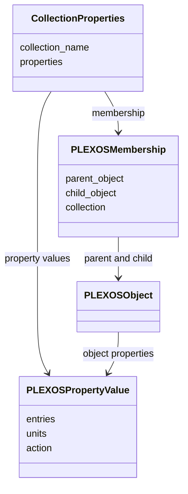
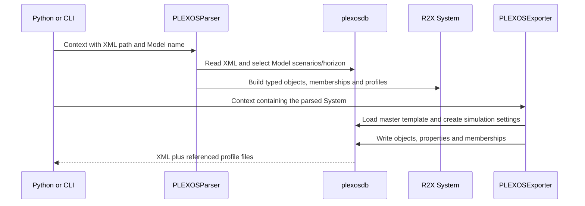

The input is a relational XML database: objects have classes, properties can
carry scenario/band/date dimensions, and memberships connect objects through
collections. Flattening everything into one numeric table would lose information
needed when writing XML again.

## Why properties keep multiple entries

A generator property may differ by scenario, band, timeslice or date window.
`PLEXOSPropertyValue` retains those records, rather than replacing them with one
number during ingest. Scenario priority and horizon selection determine the
values exposed for a particular context. The parser derives priority from the
selected Model's scenarios and resolves its horizon when available.

The scenario/horizon helpers currently use module-level state. Their context
managers restore the previous selection on exit; they do not create independent
per-system storage. Prefer scoped inspection and avoid assuming concurrent
models have isolated selection state. Read the [selection implementation](https://github.com/NatLabRockies/r2x-plexos/blob/main/src/r2x_plexos/models/context.py)
before designing concurrent workflows.

## Why relationships are supplemental attributes

A Generator-to-Node or Region-to-Generator collection is a relationship, not
another generating unit. `PLEXOSMembership` retains parent, child, collection and
membership ID. `CollectionProperties` attaches values belonging to that specific
relationship. Keeping these distinct lets the exporter recreate memberships
without counting them as ordinary system components.

That distinction is visible in the tutorial: 37 ordinary components and 34
memberships are different measures. Compare both when checking a round trip.
See [supplemental attributes](/r2x-plexos/explanation/supplemental-attributes/) and
[model definitions](https://github.com/NatLabRockies/r2x-plexos/blob/main/src/r2x_plexos/models/membership.py).

## From model selection to export

The parser prefers an `xml_file` DataStore entry; otherwise it resolves `fpath`.
Explicit filenames avoid ambiguous directory discovery. The exporter creates
simulation settings from configuration and starts from a master template supplied
by [plexosdb](https://github.com/NatLabRockies/plexosdb).
A PLEXOS version key chooses that template's database schema. It does not install
or choose an optimization engine.

A round trip preserves a usable typed representation; it does not promise
byte-for-byte XML equality, identical object ordering, or identical solve results.
Before production use, inspect exported Model/Scenario/Horizon settings and all
DataFile references in the target PLEXOS environment.

## Where translation belongs

[`r2x-core`](https://github.com/NatLabRockies/r2x-core) supplies contexts/lifecycle;
[Infrasys](https://github.com/NatLabRockies/infrasys) owns component and time-series
storage. This package owns PLEXOS model semantics and serialization.
[`r2x-plexos-to-sienna`](https://github.com/NatLabRockies/R2X/tree/main/packages/r2x-plexos-to-sienna)
provides the cross-format mapping; [`r2x-sienna`](https://github.com/NatLabRockies/r2x-sienna)
writes the resulting Sienna system. Insert translation between parser and exporter,
using the [PLEXOS-to-Sienna workflow](https://natlabrockies.github.io/R2X/how-to/plexos-to-sienna/).
