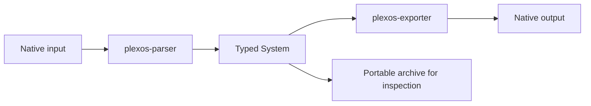

`r2x-plexos` provides two registered plugins. Start with the
[pip installation](/r2x-plexos/getting-started/installation/) for Python applications,
or install the package in the separate [r2x-cli](https://natlabrockies.github.io/r2x-cli/) environment for pipelines.

| Registered name | Public class | Role |
| --- | --- | --- |
| `plexos-parser` | [`PLEXOSParser`](/r2x-plexos/reference/api/#r2x_plexos.PLEXOSParser) | Read native input and populate the context System. |
| `plexos-exporter` | [`PLEXOSExporter`](/r2x-plexos/reference/api/#r2x_plexos.PLEXOSExporter) | Consume a System and write native output. |

This is the complete [`r2x_plugin` registration table](https://github.com/NatLabRockies/r2x-plexos/blob/main/pyproject.toml).
There are no system modifiers registered by this package. Do not expect a model class
or an upgrade helper to appear as a CLI plugin.

The parser reads native XML and profile references into PLEXOS components. The exporter consumes those components and writes native XML and profile CSVs. A parser/exporter round trip preserves a format; translating to another format needs a separate mapping plugin.



## Choose your first task

Verify discovery in the runtime where you installed the package:

```bash
r2x list r2x-plexos
```

Expect both names in the table. Inspect their actual installed options before creating a pipeline:

```bash
r2x run plexos-parser --help
r2x run plexos-exporter --help
```

Use [the round-trip tutorial](/r2x-plexos/tutorials/round-trip/) to download pinned public inputs,
parse them, check component counts, export, and inspect an archive. Use
[Python contexts](/r2x-plexos/how-to/python/) when your application needs analysis between steps.
The [Core lifecycle](https://natlabrockies.github.io/r2x-core/references/api/) explains how contexts carry configuration and systems.

For cross-format workflows, use the separate [R2X translation plugins](https://natlabrockies.github.io/R2X/)
and the destination model package. [r2x-reeds](https://natlabrockies.github.io/r2x-reeds/) supplies ReEDS parsing and system modifiers;
those registrations are not part of `r2x-plexos`.
