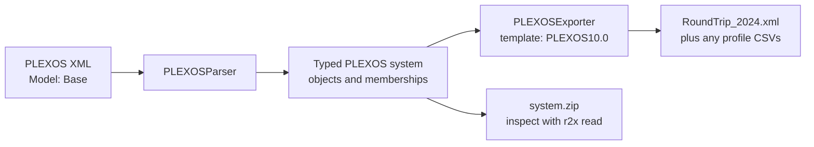

By the end, you will have parsed a public model, exported a native model, and
loaded a portable archive to check its component graph. This is a format round trip;
it does not run PLEXOS optimization or establish numerical equivalence.



## 1. Confirm the prerequisites

Complete [Installation](/r2x-plexos/getting-started/installation/),
[environment setup](/r2x-plexos/getting-started/environment/) and
[verification](/r2x-plexos/getting-started/verify/) first.
The CLI must discover `plexos-parser` and `plexos-exporter` in its managed environment.

This tutorial uses a macOS/Linux shell, `curl`, network access for the pinned
downloads, and a new working directory. A licensed PLEXOS installation is not required for this XML exercise.

## 2. Download a small, reproducible input

Choose a new directory so earlier results cannot be confused with this run:

```bash
mkdir r2x-plexos-demo
```

```bash
cd r2x-plexos-demo
```

Keep source files and output artifacts separate:

```bash
mkdir inputs outputs
```

Download the five-node XML fixture from a pinned revision. Its Model object is named `Base`; the filename is not the model name.

```bash
curl -fsSL \
  https://raw.githubusercontent.com/NatLabRockies/r2x-plexos/e562dd7226e41dd0f27f761959acff04071b271e/tests/data/5_bus_system_variables.xml \
  -o inputs/model.xml
```

Verify the downloads are present and nonempty:

```bash
ls -lh inputs
```

For your own XML, include all referenced profile files and choose the correct Model object. See [input and model selection](/r2x-plexos/how-to/python/#select-inputs-explicitly).

## 3. Describe the two steps

Save the following as `pipeline.yaml` in the current directory:

```yaml
variables:
  input_dir: inputs
  output_dir: outputs
pipelines:
  round_trip:
    - r2x-plexos.plexos-parser
    - r2x-plexos.plexos-exporter
config:
  r2x-plexos.plexos-parser:
    fpath: ${input_dir}/model.xml
    model_name: Base
    horizon_year: 2024
  r2x-plexos.plexos-exporter:
    model_name: RoundTrip
    horizon_year: 2024
    template: PLEXOS10.0
    output_path: ${output_dir}
output_folder: ${output_dir}
```

`pipelines` defines execution order; `config` gives each plugin its own settings.
`${input_dir}` and `${output_dir}` expand from `variables`.
The parser selects Model `Base`; the exporter creates a separate `RoundTrip` simulation using the PLEXOS10.0 master template. Template selection concerns XML schema, not the installed solver.

List the pipeline before executing it:

```bash
r2x run pipeline.yaml --list
```

Expect `round_trip` with two steps. Print the expanded configuration:

```bash
r2x run pipeline.yaml round_trip --print
```

Check the input paths and `Base` Model name in that output.
Preview the order without parsing any model data:

```bash
r2x run pipeline.yaml round_trip --dry-run
```

Expect `plexos-parser → plexos-exporter`. A dry run checks discovery and pipeline
configuration; it cannot prove that an XML object, JSON field, or sidecar exists.

## 4. Run and keep a portable system

```bash
r2x run pipeline.yaml round_trip --zip -o outputs/system.zip
```

The CLI reports each completed step and the saved ZIP. These are distinct outputs:

| Output | What it contains | How to read it |
| --- | --- | --- |
| `outputs/RoundTrip_2024.xml` | Native PLEXOS objects, properties, simulation settings and profile references. | PLEXOS or `plexos-parser`. |
| Profile CSVs, when present | Exported time-series values referenced by XML. | Keep with the exported model. |
| `outputs/system.zip` | Infrasys serialization of the parsed system and its storage. | `r2x read --zip` or `System.load`. |

List what this run created:

```bash
ls -lh outputs
```

The native export and the archive serve different consumers. Do not pass
PLEXOS XML to `r2x read` as if it were an Infrasys serialization.

## 5. Inspect the graph, not just the filenames

Copy the console input below without `>>>`/`...` prompts into `inspect_system.py` beside `pipeline.yaml`:

```python doctest
>>> from infrasys import Component
>>> from r2x_plexos.models import PLEXOSGenerator, PLEXOSNode, PLEXOSMembership
>>> print("System:", sys.name)
System: PLEXOS
>>> assert len(list(sys.get_components(Component))) == 37
>>> print("Components:", len(list(sys.get_components(Component))))
Components: 37
>>> print("Generators:", len(list(sys.get_components(PLEXOSGenerator))))
Generators: 9
>>> print("Nodes:", len(list(sys.get_components(PLEXOSNode))))
Nodes: 5
>>> print("Memberships:", len(list(sys.get_supplemental_attributes(PLEXOSMembership))))
Memberships: 34
>>> for generator in sys.get_components(PLEXOSGenerator):
...     print("Generator:", generator.name)
...
Generator: Alta
Generator: Brighton
Generator: Park_City
Generator: SolarPV1
Generator: SolarPV2
Generator: Solitude
Generator: Storage
Generator: Sundance
Generator: Wind
```

`r2x read` supplies the loaded system as `sys`. The imports select the actual
package-specific model classes recorded in the archive. Execute the checks:

```bash
r2x read outputs/system.zip --zip --exec inspect_system.py
```

For the pinned fixture, the observed counts are:

```text
System: PLEXOS
Components: 37
Generators: 9
Nodes: 5
Memberships: 34
```

The generator names include Alta, Brighton, Park_City, SolarPV1, SolarPV2, Solitude, Storage, Sundance and Wind. Memberships carry parent/child collection relationships rather than appearing in the ordinary component count.
Use these counts as a checkpoint for this fixture, not as expectations for a study model.
If loading or summary metadata fails, use [artifact troubleshooting](/r2x-plexos/troubleshooting/#archive-loading-fails).

## Where to go next

- [Inspect fields and time series](/r2x-plexos/how-to/inspect-system/) before changing model data.
- [Use Python contexts](/r2x-plexos/how-to/python/) when inserting custom analysis between parsing and export.
- [Translate PLEXOS to Sienna](https://natlabrockies.github.io/R2X/how-to/plexos-to-sienna/) uses the separate `r2x-plexos-to-sienna` package and `r2x-sienna` exporter.
- [Public API and defaults](/r2x-plexos/reference/) explain what each configuration field controls.

This walkthrough was executed with CLI 0.1.15 and Python 3.12, using
r2x-plexos 0.3.3, r2x-core 0.8.0, and Infrasys 1.2.0.
